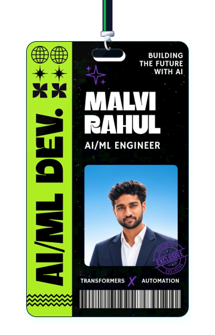

<!-- ======================================================== -->
<!--   RAHUL MALVI (@oye-rahul) - OFFICIAL GITHUB PROFILE     -->
<!--   AI/ML Engineer • AI Agent Developer • System Builder   -->
<!-- ======================================================== -->

  <!-- ================= 01. HERO SECTION: BIG COLORFUL COUNTER + BIO + BIG HANGING ID BADGE ================= -->
  <table align="center" style="border: none; border-collapse: collapse; width: 100%;">
    <tr style="border: none;">

      <!-- LEFT: BIG VIBRANT ANIME GIRLS MOE COUNTER + BIO INTRO -->
      <td align="left" valign="top" style="border: none; padding: 15px 25px; width: 55%;">
        

          
        

        <h1 align="left" style="margin-top: 10px; font-size: 34px; font-weight: 800; color: #ffffff;">Hey, i’m Rahul</h1>
        

          A machine learning engineer who creates amazing models and also you can call me an AI agent developer... hmmm now I'm thinking to learn SI means Super Intelligence. A machine learning engineer who creates amazing models and also you can call me an AI agent developer...
        

      </td>

      <!-- RIGHT: BIG ID CARD WITH SIMPLE ROPE & LOW GENTLE SWAY -->
      <td align="center" valign="top" style="border: none; padding: 10px; width: 45%;">
        
      </td>

    </tr>
  </table>

---

### ⚡ Tech Stack & Capabilities

  <!-- CATEGORIZED BADGE MATRIX -->
  <table align="center" style="border: none; border-collapse: collapse; width: 100%;">
    
    <!-- 1. PROGRAMMING LANGUAGES -->
    <tr style="border: none;">
      <td align="right" valign="middle" style="border: none; padding: 10px 16px; width: 28%; font-weight: bold; color: #38bdf8;">
        Programming Languages:
      </td>
      <td align="left" valign="middle" style="border: none; padding: 10px 16px;">
        
        
        
        
      </td>
    </tr>

    <!-- 2. FRONTEND DEVELOPMENT -->
    <tr style="border: none;">
      <td align="right" valign="middle" style="border: none; padding: 10px 16px; font-weight: bold; color: #818cf8;">
        Frontend Development:
      </td>
      <td align="left" valign="middle" style="border: none; padding: 10px 16px;">
        
        
        
      </td>
    </tr>

    <!-- 3. FRAMEWORKS - BACKEND & AI/ML -->
    <tr style="border: none;">
      <td align="right" valign="middle" style="border: none; padding: 10px 16px; font-weight: bold; color: #34d399;">
        Backend & AI/ML:
      </td>
      <td align="left" valign="middle" style="border: none; padding: 10px 16px;">
        
        
        
        
        
        
        
        
        
        
      </td>
    </tr>

    <!-- 4. DATABASES -->
    <tr style="border: none;">
      <td align="right" valign="middle" style="border: none; padding: 10px 16px; font-weight: bold; color: #f472b6;">
        Databases:
      </td>
      <td align="left" valign="middle" style="border: none; padding: 10px 16px;">
        
        
        
      </td>
    </tr>

    <!-- 5. DEVOPS -->
    <tr style="border: none;">
      <td align="right" valign="middle" style="border: none; padding: 10px 16px; font-weight: bold; color: #fbbf24;">
        DevOps & Cloud:
      </td>
      <td align="left" valign="middle" style="border: none; padding: 10px 16px;">
        
        
        
        
        
        
      </td>
    </tr>

    <!-- 6. BACKEND AS A SERVICE -->
    <tr style="border: none;">
      <td align="right" valign="middle" style="border: none; padding: 10px 16px; font-weight: bold; color: #a78bfa;">
        BaaS & Deployment:
      </td>
      <td align="left" valign="middle" style="border: none; padding: 10px 16px;">
        
        
        
        
      </td>
    </tr>

  </table>

---

<!-- ================= 03. COMMIT LOG: A YEAR OF BUILDING (IN GREEN) ================= -->

  

---

<!-- ================= 04. OTHER THINGS BY YOURSELF (PORTFOLIO FOLDERS) ================= -->

  <h2>Other things by your sell</h2>

  <table align="center" style="border: none; border-collapse: collapse; margin: 20px auto;">
    <tr style="border: none;">

      <!-- FOLDER 1: GLOSSY GLASS FOLDER (PROJECTS) -->
      <td align="center" valign="middle" style="border: none; padding: 15px;">
        
      </td>

      <!-- FOLDER 2: HANDHELD PORTFOLIO FOLDER -->
      <td align="center" valign="middle" style="border: none; padding: 15px;">
        
      </td>

    </tr>
  </table>

   

  <!-- ================= 04. SOCIAL PILLS BAR ================= -->
  

    
    
    
    
    
  

   

  <!-- ================= 05. MIDNIGHT LEGO CODER'S WORKSPACE ================= -->
  

    
  

# oye-rahul

