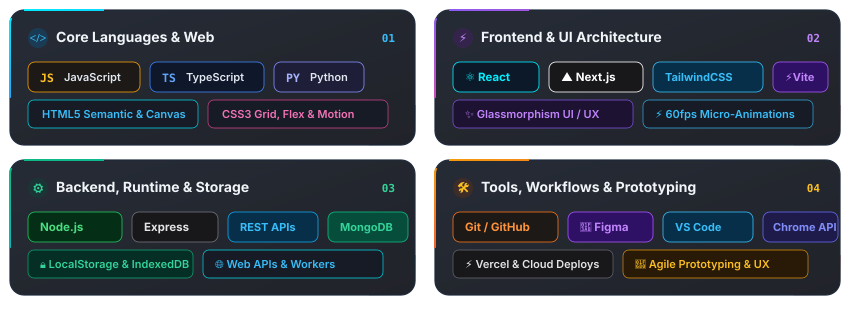

<!-- ======================================================== -->
<!--   RAHUL MALVI (@oye-rahul) - NEXT-GEN ANIMATED PROFILE   -->
<!--   Handcrafted animated SVGs, Glassmorphism & Cyber Motion -->
<!-- ======================================================== -->

  <!-- ================= 01. ANIMATED HERO TERMINAL HEADER ================= -->
  <picture>
    <source media="(prefers-color-scheme: dark)" srcset="./assets/header-animated.svg">
    <source media="(prefers-color-scheme: light)" srcset="./assets/header-animated.svg">
    
  </picture>

  <!-- QUICK SOCIAL & LIVE METRICS BAR -->
  

    
    
    
    
    
  

---

### 💻 Flagship Showcase: macOS-web (DeskTab)

  <!-- ================= 02. ANIMATED MACBOOK & DESKTAB MOCKUP ================= -->
  

  

    
    
  

> **About the Project**: **macOS-web (DeskTab)** transforms standard browser new-tabs into a desktop-grade MacBook workspace. Built natively with pure HTML5, CSS3, and modern Vanilla JS with zero heavy framework overhead, offering a live magnifying dock, desktop widgets, quick spotlight search, dynamic wallpapers, and client-side privacy.

---

### ⚡ Technical Arsenal & Core Stack

  <!-- ================= 03. ANIMATED CYBER BENTO TECH MATRIX ================= -->
  

    

  <!-- SKILL ICONS GLOWING TRAY -->
  

---

### 📡 Telemetry, Quest & Diagnostics

  <!-- ================= 04. ANIMATED HUD & TELEMETRY ================= -->
  

---

### 📊 Real-Time GitHub Analytics & Activity

  <!-- SIDE BY SIDE STATS & TOP LANGUAGES -->
  <table>
    <tr>
      <td align="center" width="50%">
        
      </td>
      <td align="center" width="50%">
        
      </td>
    </tr>
  </table>

  <!-- GLOWING STREAK STATS -->
  

    
  

  <!-- GLOWING ACTIVITY GRAPH -->
  

    
  

  <!-- TROPHY SHELF -->
  

    
  

---

### 🐍 Contribution Activity Snake

  <!-- ANIMATED CONTRIBUTION SNAKE -->
  <picture>
    <source media="(prefers-color-scheme: dark)" srcset="https://raw.githubusercontent.com/oye-rahul/oye-rahul/output/github-contribution-grid-snake-dark.svg">
    <source media="(prefers-color-scheme: light)" srcset="https://raw.githubusercontent.com/oye-rahul/oye-rahul/output/github-contribution-grid-snake.svg">
    
  </picture>

---

  <!-- ================= 05. ANIMATED CYBER HORIZON FOOTER ================= -->
  

  

    
  

